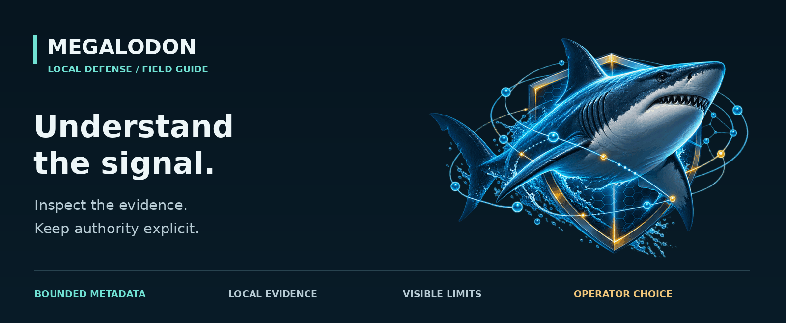
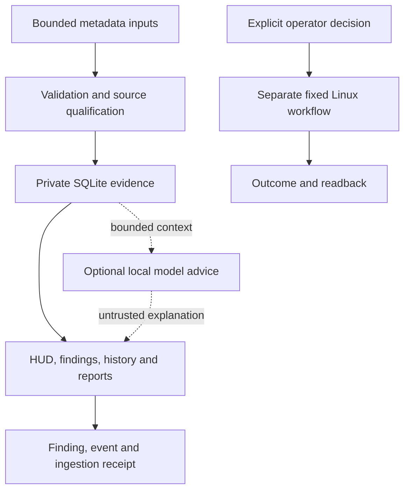

# MEGALODON field guide

**Understand your sources. Inspect what happened. Choose the next step.**

MEGALODON brings bounded network metadata, local evidence, visual investigation,
and separately scoped Linux workflows into one workspace. Start with the task
you have. Every guide keeps source, uncertainty, and authority visible.

| I want to… | Start here | Then inspect |
| --- | --- | --- |
| Open MEGALODON on Linux | [Visual quick start](gui-quick-start.md) | [Install, update, troubleshoot](local-pc-setup.md) |
| Understand the interface | [Visual tour](wiki/visual-tour.md) | [Operator guide](wiki/operator-guide.md) |
| Trace a finding to its evidence | [Findings and inspector](control-room-contract.md#qualified-finding-evidence-inspector) | [Control room contract](control-room-contract.md) |
| Audit configuration or file changes | [Host security](host-security.md) | [Background tools](background-tools.md) |
| Understand local AI | [Integrations and local AI](wiki/integrations-and-qwen.md) | [Model selection](local-model-selection.md) |
| Make a report or recover data | [Recording and reports](efficient-recording-reports.md) | [Recovery contract](sqlite-recovery-contract.md) |
| Evaluate the engineering | [Case studies](wiki/engineering-case-studies.md) | [Evidence index](wiki/evidence-index.md) |
| Contribute a bounded change | [Contribution guide](../CONTRIBUTING.md) | [Development and validation](wiki/development-and-validation.md) |

## Read the architecture

The diagram describes separate interfaces; it does not authorize operation.
The metadata reader is read-only. Current Linux HUD controls include separately
protected configuration and host workflows. Advice does not authorize them.
An imported alert, cached reference match, or model explanation is not proof of
compromise. See [security boundaries](wiki/security-boundaries.md).

## Know which document governs

[Current state and limits](current-state.md) is the dated orientation for this
documentation pass. [The complete documentation catalog](documentation-map.md)
accounts for every tracked Markdown document, including versioned contracts,
proposals, templates, and preserved history. Catalog inclusion is not technical
acceptance or a claim that every historical paragraph is current.

For intended behavior, read [SPECIFICATION.md](../SPECIFICATION.md) and
[SECURITY_REVIEW.md](../SECURITY_REVIEW.md), including their scope notes. For what
exists, inspect code and tests at the same commit. Historical acceptance counts,
issue states, research versions, and deployment receipts keep their original
dates. A fresh repository checkout does not prove an installed PC is current.

The [GitHub Wiki](https://github.com/bartytime4life/MEGALODON/wiki) is generated
from `docs/wiki/`. The separate [PC Snapshot Console](../site/README.md) imports
an address-free summary in browser tab memory; it is not a live host connection.
