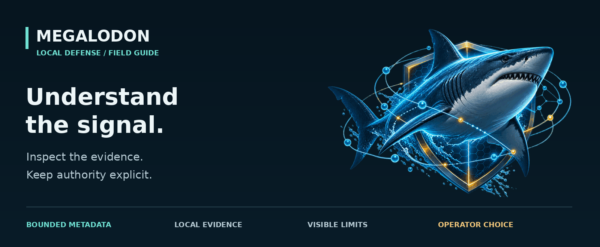
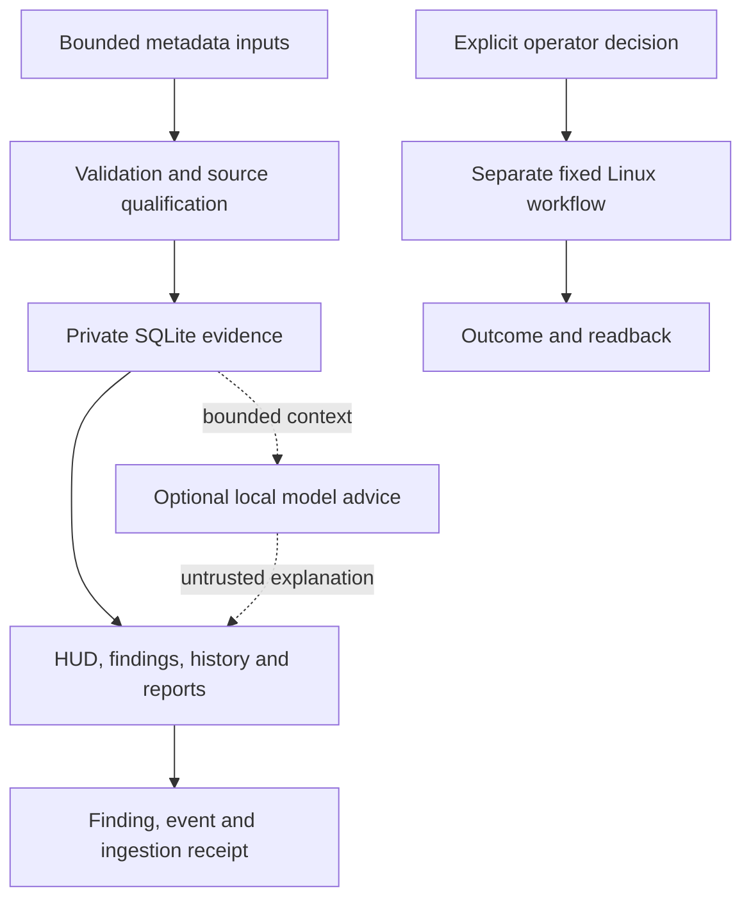

# MEGALODON field guide

**Understand your sources. Inspect what happened. Choose the next step.**

MEGALODON brings bounded network metadata, local evidence, visual investigation,
and separately scoped Linux workflows into one workspace. Start with the task
you have. Every guide keeps source, uncertainty, and authority visible.

| I want to… | Start here | Then inspect |
| --- | --- | --- |
| Choose the next evidence task | [Guided HUD](dashboard-operations.md#read-the-interface-in-evidence-order) | [Findings](findings-review.md), connection context or [Reports](efficient-recording-reports.md) |
| Manage background startup | [Installed service and login startup](local-pc-setup.md#optional-start-the-installed-hud-at-login) | [Collector scope and saved preferences](background-tools.md) |
| Open MEGALODON on Linux | [Visual quick start](gui-quick-start.md) | [Install, update, troubleshoot](local-pc-setup.md) |
| Prepare Suricata offline configuration | [Installing Suricata and configuration script](installing-suricata.md) | [Pinned alert-only producer boundary](../contracts/suricata-eve/v1/producer/README.md) |
| Prepare ARTEX defenses on Google Wifi | [Home-network defense and visibility](artex-home-network-defense.md) | [Local response limits](visual-operations-defense.md#temporary-containment) |
| Choose a router or switch capture path | [Router compatibility guide](router-compatibility.md), [switch compatibility](switch-compatibility.md) | Setup → Traffic → Router, switch and capture placement guide |
| Explore security mathematics | [Interactive science in Help](security-science-lab.md) | [Exact CLI workload projection](alert-workload-lab.md), [research and timing mathematics](science-and-math.md) |
| Protect incoming access on this PC | [Finite host protection](host-protection.md) | [Defense and audit boundaries](visual-operations-defense.md) |
| Understand the interface | [Visual tour](wiki/visual-tour.md) | [Three investigation journeys](wiki/investigation-journeys.md) |
| Trace a finding to its evidence | [Findings and inspector](control-room-contract.md#qualified-finding-evidence-inspector) | [Control room contract](control-room-contract.md) |
| Assess host recovery preparation | [Recovery readiness and external receipts](host-backup-evidence.md) | [Host-security limits](host-security.md#recovery-readiness-in-setup) |
| Explore useful applications | [Practical walkthroughs](wiki/practical-applications.md) | [Technical deep dive](wiki/technical-deep-dive.md) |
| Audit configuration or file changes | [Host security](host-security.md) | [Background tools](background-tools.md) |
| Understand local AI | [Integrations and local AI](wiki/integrations-and-qwen.md) | [Model selection](local-model-selection.md) |
| Read the host security report and review a finding | [Host report and guided review](security-report.md) | [Watches and collection gaps](scheduling.md) |
| Read telemetry history or recover a database | [Recording and reports](efficient-recording-reports.md) | [SQLite recovery contract](sqlite-recovery-contract.md) |
| Evaluate the engineering | [Case studies](wiki/engineering-case-studies.md) | [Evidence index](wiki/evidence-index.md) |
| Contribute a bounded change | [Contribution guide](../CONTRIBUTING.md) | [Development and validation](wiki/development-and-validation.md) |

For synthetic review workload and provenance measurements, use the
[offline layered evaluation](layered-evaluation.md). Operational detection accuracy
remains unmeasured.
For the mathematical changes, primary sources and next experiments, read
[science and mathematics](science-and-math.md). For a proposed synthetic review comparison,
see the [agent harness playbook](agent-harness-playbook.md).

## Read the architecture

The diagram describes separate interfaces; it does not authorize operation.
Its advice path describes the bounded advisory contract. Operational generation
currently remains [UNBOUND](qwen-runtime-unbound.md); explicit catalog/selection
and the fixed no-telemetry READY diagnostic retain their separate preparation scope.
The metadata reader is read-only. Current Linux HUD controls include separately
protected configuration and host workflows. Advice does not authorize them.
An imported alert, cached reference match, or model explanation is not proof of
compromise. See [security boundaries](wiki/security-boundaries.md).

## Know which document governs

[Current state and acceptance](current-state.md#november-26-source-and-acceptance-map)
maps each subsystem to its implementation, hosted checks and missing operational
evidence. [The documentation catalog](documentation-map.md) indexes every
tracked Markdown path, including contracts, proposals, templates and historical
records. The [November 11 refresh](documentation-refresh-2026-11-11.md) and
[October reconciliation](documentation-refresh-2026-10-22.md) keep their own
source pins and evidence.

For intended behavior, read [SPECIFICATION.md](../SPECIFICATION.md) and
[SECURITY_REVIEW.md](../SECURITY_REVIEW.md), including their scope notes. For what
exists, inspect code and tests at the same commit. Historical acceptance counts,
issue states, research versions, and deployment receipts keep their original
dates. A fresh repository checkout does not prove an installed PC is current.

The [GitHub Wiki](https://github.com/bartytime4life/MEGALODON/wiki) is generated
from `docs/wiki/`. The separate [PC Snapshot Console](../site/README.md) imports
an address-free summary in browser tab memory; it is not a live host connection.

[Animated technical tour](wiki/visual-tour.md#animated-technical-explainers) includes still alternatives and public-source provenance.
