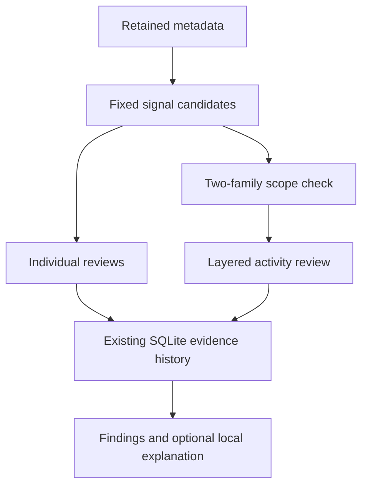

# Layered activity review

MEGALODON can now bring two different kinds of network signal together in the
existing Findings workspace. A discovery pattern alongside recurring connections,
for example, becomes one additional review with separate source labels and
measurements. The individual findings remain available. The combined review
invites investigation; it neither raises incident severity nor declares malware.

This is a bounded step toward **Layered Operations Defense**. It adds original
correlation code to the existing evidence database and optional explanation
pipeline. It does not train a model, replace the database, or enable a dormant
model binding. Canonical Qwen acceptance remains a separate gate.

## What qualifies

Only fixed network candidates produced in the same completed hour are considered.
Both must have the exact same canonical recorded address and reported interface,
valid evidence references, and retained segment dependencies. Missing interfaces,
different address spellings, different hours and malformed provenance cannot
complete a pair. Source labels are retained as declared, not authenticated.

[Timing-review evidence](pattern-evidence-provenance.md) describes how cadence
and port-53 burst components retain their actual supporting references and
exclude old connection starts from a newly processed hour.

| Family | Existing signals |
| --- | --- |
| Discovery | `PORT_SCAN`, `HOST_FANOUT` |
| Traffic volume | `SYN_FLOOD` |
| DNS-related observations | `DNS_TUNNELING`, `PORT_53_BURST` |
| Cadence | `REGULAR_INTERVAL` |
| Baseline change | `NEW_DESTINATION_PORT`, `PROTOCOL_SHIFT`, `SERVICE_SHIFT` |

Two rules from the same family do not qualify. Repeated records, model opinions,
reference documents, operator feedback, generic address observations and earlier
combined reviews cannot create another family. Packet counts and flow counts are
never added. Host-audit findings are not joined to network addresses without a
verified identity relationship.



The relationship is **same recorded address, interface and hour**. It is not a
verified host identity, an ordered attack sequence, successful access or independent
sensor corroboration. NAT, reused addresses, overlapping sensors and legitimate
scheduled work remain alternative explanations. An empty combined-review list
does not establish safety or complete observation.

## Storage, bounds and authority

- At most 64 hourly candidates are examined and eight combined reviews emitted.
  One pair per address/interface is chosen by stable rule/source/measurement/ID
  ordering. This is deterministic selection, not a ranking of threat likelihood.
- The pair's complete candidate-reference union (at most 48) and segment
  dependency union (at most 256) are retained. These are the already bounded
  individual candidates' references, not a promise of complete raw evidence.
  Existing selected-finding views may display a smaller reference page.
- Earlier comparison dependencies retain their earliest `source_start`.
  Existing SQLite retention, restart restoration and source retirement apply.
  No schema migration or second database is introduced.
- Existing individual candidates keep priority within the 64-candidate hourly
  admission cap. Work/dependency limits and invalid provenance produce coverage
  notes. Combined coverage notes disclose when component notes are truncated.
- The existing 24-hour fingerprint cooldown applies to the same address,
  interface and pair of rule/source/measurement identities.
- `action_status` remains `not_attempted` and the fixed recommendation is
  `evidence_summary`. A model cannot replace it with containment. No collector,
  process, network connection, firewall rule or model invocation is added by the
  correlator. Existing explicit response workflows retain their separate gates.

The paired review can be explained by the already configured local-model path
only when that path is admitted. Core correlation works without a model. Model
text remains untrusted commentary and cannot become another signal.

## Reproduce safely

From the reviewed checkout with its existing test environment:

```bash
python -m compileall -q megalodon tests
PYTEST_DISABLE_PLUGIN_AUTOLOAD=1 PYTEST_PLUGINS= PYTEST_ADDOPTS= \
  python -m pytest -ra tests/test_layered_review.py tests/test_security_patterns.py tests/test_findings_review.py
python tools/replay_layered_review.py
```

The replay uses synthetic metadata, including identical benign and suspicious
cases that deliberately produce the same review. It opens no sensors, invokes
no model and applies no host action. Passing it establishes the bounded grouping
contract; it does not measure operational detection or false-positive rates.

## Research basis and remaining acceptance

[NIST SP 800-94](https://www.nist.gov/publications/guide-intrusion-detection-and-prevention-systems-idps)
describes complementary network, behavior and host detection technologies.
[ATLANTIDES (LISA 2007)](https://www.usenix.org/conference/lisa-07/atlantides-architecture-alert-verification-network-intrusion-detection-systems)
studies alert verification using correlated service-output anomalies. These are
design references, not evidence that MEGALODON implements those systems or
inherits their measured results. This implementation groups existing metadata
signals for review and does not discard presumed false positives.

Representative authorized Linux observations, independent review and measured
operator usefulness remain acceptance gates. No claim of malware elimination,
automated prevention, installed-host deployment or qualified AI follows from
this change.
