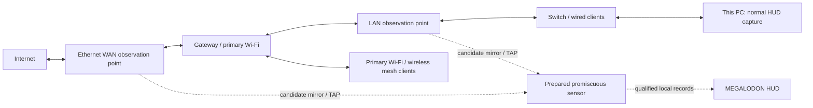

# Router compatibility and capture placement

Reference date: **2026-11-16**. Status: an implemented read-only Setup guide,
with **25 named router families plus a generic profile**. A profile is a starting
point for reviewing a model and its packet path, not universal compatibility
certification or evidence that any device is being monitored.

In **Setup → Traffic**, choose **Router family** and **Capture placement** to
change the displayed guidance. The initial choices are the generic profile and
this PC's normal connection. Choices last only while the page remains open;
heartbeat refreshes preserve them. Selection performs no network request,
saves no coverage assertion, accepts no router credentials and changes no router,
capture interface, firewall or service configuration. Publisher links open only
when followed. The profile catalog is
[`megalodon/router_compatibility.py`](../megalodon/router_compatibility.py).

## What is implemented

The supported application is the local Linux HUD. Collection and analysis paths
have different evidence and visibility boundaries:

| Path | Current implementation | Boundary |
| --- | --- | --- |
| This PC's normal connection | Explicit HUD packet-metadata capture on a selected interface; optional bounded Zeek samples | Usually this PC's traffic plus some broadcast/multicast. Sharing a router does not expose every client. Monitoring pauses when this PC sleeps or the HUD stops. |
| Existing local sensor records | Managed collection can accept the supported Suricata EVE flow/alert JSONL and Zeek JSON `conn.log` profiles when the collector and evidence policy permit | Local files and supported record schemas only. A file's existence or a producer-reported name/interface does not verify sensor coverage, run identity or rules provenance. |
| Completed capture or log | Separate Linux offline TShark adapter for supported uncompressed PCAP/PCAPNG; offline Zeek JSON/TSV `conn.log` adapters with a declared producer version | Bounded private reports for the supplied file and time interval. No automatic import into live capture or the core audit store, and no certification of arbitrary vendor exports. |
| Selected Suricata consumer database | Optional `--suricata-db` read-only startup snapshot of a compatible store | Separate evidence projection, not an EVE-file importer, remote receiver or live polling feed. |

See [offline analysis](offline-analysis.md) for the actual input contract and
isolated analyst procedure, and the
[Suricata evidence projection](suricata-evidence-projection.md) for the separate
database view. Flow records, packet records, router statistics and alerts retain
their own units; their counts must not be added together as packet totals.

**External mirror/TAP collection still requires preparation and qualification.**
Normal HUD capture and the bounded Zeek sampler pass `-p` to dumpcap and do not
enable promiscuous mode. Choosing a mirror placement or selecting an interface
does not change that behavior. Use a separately prepared promiscuous sensor and
verify its local output against an existing ingestion contract before relying on
it. The guide supplies neither a remote sensor transport nor a mirror toggle.
A spare switch port is not automatically a mirror.

MEGALODON currently has **no direct router syslog, CEF, NetFlow, IPFIX, sFlow or
TZSP receiver/adapter**, nor a generic router CSV/JSON importer. Vendor support
for one of these exports does not make it an implemented MEGALODON integration.
There is no router management API, credential store or autonomous router control
in this guide.

## Observation points and missing paths

This schematic shows candidate placements, not an installed topology. Each
mirror/TAP must support the actual link and both traffic directions.

A LAN observation point may retain client addresses before gateway NAT, but
traffic switched elsewhere or carried by the primary Wi-Fi/mesh backhaul can
bypass it. A WAN observation point covers Internet traffic crossing that uplink;
IPv4 NAT can hide individual client identity, and IPv6 needs separate mapping.
Local-only traffic and other uplinks remain outside that view. Integrated cable,
DSL and cellular gateways may have no accessible Ethernet WAN to observe.
Encryption, VPNs and encrypted DNS constrain passive inspection at either point.

Keep a sensor's management connection on a protected LAN and its capture port
without an IP address. Link speed, VLAN tags, encapsulation and aggregate copied
bandwidth must fit the capture path. Any topology change requires its own review;
this guide neither installs hardware nor changes bridge, AP or passthrough mode.

## Router-family references

The following groups match the Setup catalog. These are publisher-documented
features and questions to review, not tested integrations. All proposed external
placements still require the qualification below. A router/AP/bridge mode can
remove security or management functions; changing it is not a prerequisite for
ordinary PC capture.

### General

| Profile | Review before broader collection | Official references |
| --- | --- | --- |
| Other router / model unknown | Start with this PC; establish a verified observation point before claiming broader visibility. | [Wireshark Ethernet capture placement](https://wiki.wireshark.org/CaptureSetup/Ethernet) |

### Consumer routers and mesh

| Profile | Review before broader collection | Official references |
| --- | --- | --- |
| Google Wifi / Nest Wifi | Single-device bridge support does not extend to a multi-point mesh. Review guest-device sharing and wireless backhaul. | [Google bridge and mesh restrictions](https://support.google.com/googlehome/answer/6240987?hl=en); [Google guest-network sharing](https://support.google.com/googlehome/answer/6327302?hl=en) |
| Amazon eero | Bridge mode retains a gateway eero topology and removes several controls. Qualify every client path. | [eero bridge topology](https://prod.eero.com/support/articles/what-is-bridge-mode); [eero bridge feature limits](https://prod.eero.com/support/articles/what-features-do-i-lose-if-i-put-my-eeros-in-bridge-mode); [eero guest networking](https://www.eero.com/support/articles/how-do-i-share-my-eero-network-with-guests) |
| TP-Link Deco | AP mode removes gateway functions, including documented Device Isolation. Guest local access is a separate setting. | [Deco router and AP modes](https://www.tp-link.com/us/support/faq/2399/); [Deco guest networking](https://www.tp-link.com/us/support/faq/1460/) |
| TP-Link Archer / EasyMesh | EasyMesh AP and guest/IoT behavior depend on model, hardware revision, region and firmware. | [TP-Link EasyMesh FAQ](https://www.tp-link.com/us/support/faq/3529/); [TP-Link AP-mode support updates](https://community.tp-link.com/en/home/forum/topic/697572) |
| NETGEAR Orbi | Qualify AP topology and guest behavior per model. Internet access controls do not establish LAN isolation. | [Orbi AP setup](https://kb.netgear.com/31218/How-do-I-configure-my-Orbi-router-to-act-as-an-access-point); [Orbi guest controls](https://kb.netgear.com/31579/How-do-I-set-up-a-guest-network-on-my-Orbi-WiFi-System); [NETGEAR Internet-access control scope](https://kb.netgear.com/24830/How-do-I-use-access-control-to-allow-or-block-devices-from-accessing-the-Internet-on-my-Nighthawk-router-or-Orbi-system) |
| NETGEAR Nighthawk | AP mode loses features; documented access blocking can leave local-network connectivity intact. | [NETGEAR AP-mode limitations](https://kb.netgear.com/000061927/What-is-the-difference-between-router-mode-and-AP-mode); [NETGEAR Internet-access control scope](https://kb.netgear.com/24830/How-do-I-use-access-control-to-allow-or-block-devices-from-accessing-the-Internet-on-my-Nighthawk-router-or-Orbi-system) |
| ASUS / AiMesh | Qualify AiMesh AP mode; the cited Access Intranet control applies to wireless-router mode only. Remote logging needs an adapter. | [ASUS AiMesh AP operation](https://www.asus.com/support/faq/1043044/); [ASUS remote system logging](https://www.asus.com/us/support/faq/1044954/); [ASUS guest intranet controls](https://www.asus.com/support/faq/1009857/) |
| Linksys mesh / Velop | Intelligent Mesh bridge guidance does not certify every Velop generation or expose all wireless paths. | [Linksys Intelligent Mesh FAQ](https://support.linksys.com/kb/article/331-en/) |
| Synology Router / SRM | SRM Internet-traffic statistics exclude LAN traffic and are not a MEGALODON evidence feed. | [Synology SRM traffic monitor scope](https://kb.synology.com/en-global/SRM/help/SRM/NetworkCenter/traffic_monitor) |
| D-Link consumer routers / mesh | The linked DIR-612 AP example is model-specific; it does not certify other D-Link families or support lifetimes. | [D-Link model-specific AP example](https://support.dlink.com.sg/consumer/wi-fi-router/dir-612/faqs/how-to-set-the-d-link-dir-612-router-as-a-bridge-access-point-mode) |
| Tenda / nova mesh | The linked mesh guide documents router/AP modes and feature losses; verify node model and backhaul. | [Tenda whole-home mesh mode guide](https://static.tenda.com.cn/tdeweb/download/MX3/MX3%20User%20Guide.pdf) |
| HUAWEI WiFi / Mesh | Check exact Bridge/AP and Mesh+ wiring instructions; AP support supplies no telemetry adapter. | [HUAWEI wired bridge guidance](https://consumer.huawei.com/en/support/content/en-us15806362/) |
| GL.iNet | System-log exports are not packets. Vendor firmware need not support every upstream OpenWrt feature. | [GL.iNet log export](https://docs.gl-inet.com/router/en/4/interface_guide/log/); [GL.iNet operating modes](https://docs.gl-inet.com/router/en/4/interface_guide/network_mode/) |
| FRITZ!Box | Model-specific LAN/Internet traces are candidates for format-checked offline analysis; support TXT is different evidence. | [FRITZ!Box 7590 LAN traces](https://fritz.com/en-pl/apps/knowledge-base/fritz-box-7590/1572_Making-a-packet-trace-LAN-and-generating-support-information-for-the-FRITZ-Box); [FRITZ!Box 7490 Internet traces](https://fritz.com/en/apps/knowledge-base/FRITZ-Box-7490/1387_Making-a-packet-trace-internet-and-generating-support-information-for-the-FRITZ-Box); [FRITZ!Box IP-client mode](https://uk.fritz.com/service/knowledge-base/dok/FRITZ-Box-7490/3244_Setting-up-the-FRITZ-Box-as-an-IP-client/) |

### Managed networks and router operating systems

| Profile | Review before broader collection | Official references |
| --- | --- | --- |
| Ubiquiti UniFi | Qualify switch mirroring; gateway flow exports and CEF logs currently have no direct MEGALODON adapters. | [UniFi switch mirroring](https://help.ui.com/hc/en-us/articles/33402927617047-UniFi-Switch-Settings); [UniFi traffic flow requirements](https://help.ui.com/hc/en-us/articles/32201256219799-Traffic-Flows-and-Traffic-Logging-in-UniFi-Network); [UniFi CEF log export](https://help.ui.com/hc/en-us/articles/33349041044119-UniFi-System-Logs-SIEM-Integration) |
| TP-Link Omada | Qualify mirror support by gateway/switch revision and controller version. Remote logging requires a future adapter. | [Omada port-mirroring guidance](https://community.tp-link.com/en/home/kb/detail/412708); [Omada controller logging configuration](https://www.tp-link.com/us/user-guides/omada-sdn-software-controller/chapter-4-configure-the-network-with-omada-sdn-controller.html) |
| MikroTik RouterOS | Completed supported sniffer files can use offline analysis. Offload and FastPath/FastTrack affect visibility; TZSP/flow receivers are absent. | [RouterOS packet sniffer and visibility limits](https://manual.mikrotik.com/docs/diagnostics-monitoring-and-troubleshooting/packet-sniffer/); [RouterOS Traffic Flow](https://manual.mikrotik.com/docs/diagnostics-monitoring-and-troubleshooting/traffic-flow/) |
| OpenWrt | Qualify tcpdump packages, target/release, capacity and offload. This guide does not recommend firmware flashing. | [OpenWrt tcpdump and Wireshark](https://openwrt.org/docs/guide-user/firewall/misc/tcpdump_wireshark); [OpenWrt system logging](https://openwrt.org/docs/guide-user/base-system/system_configuration) |
| pfSense CE / Plus | Completed captures can use offline analysis. Native pflow requires Plus 24.03 or later; optional softflowd is separate. | [pfSense packet capture](https://docs.netgate.com/pfsense/en/latest/diagnostics/packetcapture/index.html); [pfSense Plus pflow](https://docs.netgate.com/pfsense/en/latest/firewall/pflow.html); [pfSense softflowd](https://docs.netgate.com/pfsense/en/latest/recipes/netflow-with-softflowd.html); [pfSense remote logging](https://docs.netgate.com/pfsense/en/latest/monitoring/logs/remote.html) |
| OPNsense | Completed PCAP is a candidate offline input. NetFlow/syslog need adapters; ingress/egress can duplicate NAT observations. | [OPNsense packet capture](https://docs.opnsense.org/manual/diagnostics_interfaces.html); [OPNsense NetFlow scope](https://docs.opnsense.org/manual/netflow.html); [OPNsense logging settings](https://docs.opnsense.org/manual/settingsmenu.html) |

### ISP gateways

| Profile | Review before broader collection | Official references |
| --- | --- | --- |
| Xfinity xFi gateways | Bridge mode changes private Wi-Fi/routing and xFi features. Integrated modem paths may lack an Ethernet WAN observation point. | [Xfinity bridge-mode behavior](https://www.xfinity.com/support/articles/wireless-gateway-enable-disable-bridge-mode) |
| AT&T BGW / Pace / NVG gateways | BGW IP Passthrough and Pace DMZplus differ from true bridging. Check gateway/service instructions and bypass paths. | [AT&T BGW IP Passthrough](https://www.att.com/support/article/internet/KM1322413/); [AT&T passthrough and DMZplus](https://www.att.com/support/smallbusiness/article/internet/KM1188700/); [AT&T bridge-mode distinction](https://www.att.com/support/smallbusiness/article/internet/KM1188698/) |
| Verizon Fios | G3100 remote-log documentation is model-specific. Review Fios topology separately from cellular gateways. | [Verizon Fios G3100 manual](https://www.verizon.com/content/dam/verizon/support/consumer/documents/internet/fios-router-user-guide.pdf) |
| Verizon 5G / Internet Gateway | Model-specific passthrough changes port/Wi-Fi behavior; cellular WAN has no ordinary Ethernet TAP point. | [Verizon model-specific IP passthrough](https://www.verizon.com/support/knowledge-base-301824/) |
| Spectrum Advanced WiFi | App settings and device lists do not establish telemetry compatibility. Qualify actual modem/router wiring and management authority. | [Spectrum Advanced WiFi settings](https://www.spectrum.net/support/internet/advanced-wifi-advanced-settings) |

The pfSense distinction is material: native firewall `pflow` export is available
in **pfSense Plus 24.03 and later**, and is not a CE feature. The separately
installed **softflowd add-on** is another NetFlow route; it must not be described
as native pflow or as CE-exclusive. Neither export currently has a MEGALODON
receiver. See the [Netgate pflow contract](https://docs.netgate.com/pfsense/en/latest/firewall/pflow.html)
and [softflowd package recipe](https://docs.netgate.com/pfsense/en/latest/recipes/netflow-with-softflowd.html).

Source retrieval limits for this dated review: direct OpenWrt documentation
requests encountered **Anubis** access protection, so the capture/logging notes
used indexed text from the official OpenWrt pages. Synology's direct page
retrieval exposed a page shell or failed to fetch; its Internet-only monitoring
scope was checked against indexed official Knowledge Center text. Indexed text
is not a verified complete page. Recheck the current original documentation and
exact product before making configuration decisions. The table preserves the
catalog's canonical publisher URLs rather than linking search results.

## Qualify one concrete installation

Record the exact model, hardware revision, firmware, controller/software version,
operating mode and wired/wireless backhaul for every relevant router, AP and
switch. Keep a local diagram of the capture interface, mirrored ports/directions,
VLANs, WAN paths, guest/IoT networks and intended blind spots. A family name and a
successful import are insufficient to establish these facts.

Use authorized, benign test traffic between known devices and services. Record
the test interval and expected path, then check:

1. **Both directions:** requests and responses reach the sensor for each claimed
   path. Exercise a second client, not only the monitoring PC.
2. **IPv4 and IPv6:** qualify each in use, including attribution across NAT and
   multiple addresses. Mark an unavailable family as untested, not covered.
3. **Wired, Wi-Fi, mesh, guest and IoT:** test their actual uplinks and authorized
   local paths separately. A guest label or Internet block does not prove LAN
   isolation; check allowed shared-device exceptions.
4. **Loss and continuity:** inspect mirror, NIC and sensor drop counters under
   representative ordinary load; verify both-direction aggregation capacity,
   VLAN preservation, timestamps, log rotation, accepted/rejected records and
   ingestion gaps. Hardware offload can bypass a router CPU sniffer.
5. **Evidence identity and limits:** retain the sensor/interface scope and source
   format with the result. Missing run, engine or rule provenance remains
   unknown. Record sampling, encryption and unseen-path limits explicitly.

Keep this qualification as a local, dated record for that exact installation.
The selector does not save it or promote it into a verified-coverage status.
Successful traffic ingestion also does not measure attack-detection accuracy.
Review findings before using separate, user-approved response controls; this
guide does not issue isolation commands or test with malware.

## Proposed next priorities

These are proposals, not delivered adapters or automatic setup actions:

1. Qualify the existing PC capture and a bounded saved-file workflow on the exact
   hardware, preserving accepted/rejected counts and source identity.
2. If broader visibility is needed, qualify one prepared external sensor and its
   existing local ingestion path before adding more observation points.
3. Develop an explicit mirror-sensor capture mode with dedicated-interface
   checks, promiscuous capture, loss reporting and qualification receipts. The
   current HUD's normal capture mode does not provide this feature.
4. Add bounded export validators, then versioned syslog/CEF adapters, followed
   by NetFlow/IPFIX adapters. Collect authorized examples and define provenance,
   limits and negative tests first. Flow records, logs, sFlow and TZSP need
   distinct contracts; none substitutes for complete packet or alert evidence.
5. Review vendor management and isolation controls separately, after observation
   works. Any future write adapter needs explicit scope, preview and recovery;
   read-only compatibility does not imply router-control support.

Implementation priorities do not establish a delivery date, a certified vendor
list, network-wide protection or authority to reconfigure a router.
