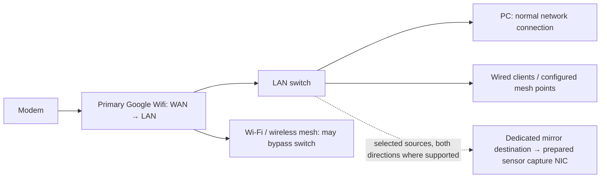

# Switch compatibility and mirror placement

Reference date: **2026-11-16**. Setup → Traffic now includes **Switch family**
alongside Router family and Capture placement. The catalog contains **13 named
switch families and three general choices**: no switch, unmanaged, and unknown
managed model. The default is no switch; this is a guide choice, not detected
hardware. All three choices are independent and last only for this page visit.
They do not validate a combined topology or configure any network equipment.

**Connectivity and monitoring are separate.** A suitable Ethernet switch can
carry this PC's ordinary traffic without a MEGALODON vendor adapter. A successful
connection does not make other clients' traffic visible. Check negotiated link
speed, cabling/transceivers, VLAN membership and the switch's actual features.
PoE supplies power; it does not provide a packet feed. Marketing labels such as
smart, managed and Unmanaged Pro are insufficient to establish mirror support.

The [router guide](router-compatibility.md) defines the existing ingestion paths.
Normal HUD capture and the bounded Zeek sampler pass `-p` to dumpcap and do not
enable promiscuous mode. Mirror/TAP collection therefore needs a separately
prepared sensor and verified local output, or a supported completed capture for
[offline analysis](offline-analysis.md). A guide selection does not change that.
There is no switch discovery/control API, RSPAN provisioning, ERSPAN tunnel
decapsulation, or native SNMP, syslog, sFlow or NetFlow/IPFIX receiver in this
addition. Controller counters and graphs remain separate from packet evidence.

## Google Wifi placement

For the currently described direct PC connection, no switch is required. If a
switch is added for LAN ports or wired backhaul, Google's documented topology
places it **downstream of the primary router's LAN port**. A downstream mirror
can observe selected wired paths; the primary router's own Wi-Fi and wireless
mesh traffic may bypass it. See Google's [hardwiring diagrams](https://support.google.com/googlehome/answer/7215624?hl=en).

Keep sensor management on a separate normal connection. A mirror destination
may lose ordinary forwarding, so it should not casually replace the PC's sole
management port or the router uplink. An Internet-side observation point is a
different design: keep WAN and LAN segments isolated and qualify it separately.

Google recommends an unmanaged switch, or a managed switch with STP disabled
and BPDUs forwarded when STP is disabled, for its documented mesh setup.
That is **Google-specific guidance**, not a general instruction to disable loop
protection across a network. Review the exact switch, mesh wiring and a
loop-free design before any such change; this guide applies none.
[Google's switch requirements](https://support.google.com/googlehome/answer/6274262?hl=en)

## Family references

These are documented candidate paths, not hardware certifications. Every local
mirror needs a prepared sensor and exact-model qualification. Source counts,
directions, VLAN handling and destination restrictions can change with firmware
and management mode. Full per-profile references are also visible in the HUD
and in [the static catalog](../megalodon/switch_compatibility.py).

| Family | Model or mode boundary to check | Publisher reference |
| --- | --- | --- |
| TP-Link Easy Smart | Hardware revision, ingress/egress selection and LAG exclusions | [Utility guide](https://support.omadanetworks.com/en/document/112827/) |
| TP-Link JetStream / Omada | Standalone versus controller mode; the current controller procedure requires 6.0+ | [Current mirroring guide](https://support.omadanetworks.com/en/document/116695/) |
| NETGEAR Plus / Smart / Insight | Source counts vary: the cited GS116EP/EPP guide permits one source; do not inherit another model's limit | [GS116EP/EPP manual](https://www.downloads.netgear.com/files/GDC/GS116EP/GS116EP_GS116EPP_UM_EN.pdf), [Insight diagnostics](https://kb.netgear.com/000048445/How-do-I-use-the-device-diagnostic-options-in-the-Insight-app) |
| Ubiquiti UniFi | Port features depend on switch model, firmware and controller | [Switch settings](https://help.ui.com/hc/en-us/articles/33402927617047-UniFi-Switch-Settings) |
| MikroTik SwOS / RouterOS | Exact switch chip, OS and version; SwOS and RouterOS controls are not interchangeable | [SwOS manual](https://help.mikrotik.com/docs/spaces/SWOS/pages/76415036/CRS3xx%20and%20CSS3xx%20series%20Manual), [dated Prestera guide](https://help.mikrotik.com/docs/spaces/ROS/pages/30474317/Marvell%2BPrestera%2Bswitch%2Bchip%2Bfeatures) |
| D-Link Smart / EasySmart | The reference covers DGS-1100-05/05PD/08/08P Rev.B1, including source/destination restrictions | [Revision-specific manual](https://support.dlink.com/resource/PRODUCTS/DGS-1100-SERIES/DGS-1100-05_05PD_08_08P_REVB_MANUAL_v2.21_WW_EN.pdf) |
| Zyxel managed / Nebula | Exact switch support and current controller source/session limits | [Nebula mirroring](https://mysupport.zyxel.com/hc/en-us/articles/360014543320-Nebula-Debugging-Port-mirroring-Packet-Capturing) |
| Cisco Catalyst | The reference is 9300 IOS XE 17.15; SPAN, RSPAN and ERSPAN differ | [SPAN/RSPAN guide](https://www.cisco.com/c/en/us/td/docs/switches/lan/catalyst9300/software/release/17-15/configuration_guide/nmgmt/b_1715_nmgmt_9300_cg/configuring_span_and_rspan.html) |
| Cisco Business CBS250 / CBS350 | Published local source limits differ: four versus eight ports/VLANs | [CBS250 datasheet](https://www.cisco.com/c/en/us/products/collateral/switches/business-250-series-smart-switches/nb-06-bus250-smart-switch-ds-cte-en.html), [CBS350 datasheet](https://www.cisco.com/c/en/us/products/collateral/switches/business-350-series-managed-switches/datasheet-c78-744156.html) |
| HPE Networking Instant On | 1930 local management and cloud management have different session, VLAN-source and destination limits | [1930 local guide](https://arubanetworking.hpe.com/techdocs/hardware/switches/1930/IGSG/1930_MCG.pdf), [cloud network tools](https://www-origin.arubainstanton.com/techdocs/en/content/site-health/desktop/switch-details-net-tools.htm) |
| HPE Aruba CX | The reference is 6300/6400 AOS-CX 10.15; mirror counters alone do not prove receipt | [Monitoring guide](https://arubanetworking.hpe.com/techdocs/AOS-CX/10.15/PDF/monitoring_6300-6400.pdf) |
| Juniper EX | The reference is EX2300/3400/4300 with Junos ELS; older platforms and egress tag behavior differ | [Network management guide](https://www.juniper.net/documentation/us/en/software/junos/network-mgmt/network-mgmt.pdf) |
| Ubiquiti EdgeSwitch | Legacy ES-24-250W/500W and ES-48-500W/750W guide; not X/XP or UniFi certification | [Legacy administration guide](https://dl.ui.com/guides/edgemax/EdgeSwitch_AdminGuide.pdf) |

Research limits: the cited MikroTik RouterOS Confluence page is frozen; its
replacement returned HTTP 403 during this review. Its version-specific claims
need current-device corroboration. Juniper's HTML path was inaccessible, so the
official PDF was used. Older model examples do not establish current support
lifetimes. TP-Link's [Unmanaged Pro datasheet](https://static.tp-link.com/2019/201912/20191227/Unmanaged%20Pro%20switches%20Datasheet.pdf)
illustrates why a marketing label alone cannot classify a switch's capabilities.

## Qualify an observation point

1. Record model, hardware revision, firmware, management mode, switch chip where
   relevant, and the intended source ports/VLANs. Keep a copy of the existing
   configuration and a way to restore normal management access before changes.
2. Select the documented mirror source directions and a separate destination.
   Verify which paths cross those sources; an uplink misses local exchanges
   that stay elsewhere. Duplicate source paths can copy the same packet twice.
3. Budget aggregate traffic, not only link speed. A fully utilized 1 Gb/s link
   in both directions can require approximately 2 Gb/s of copied output before
   overhead. Multiple sources can overload a same-speed destination. Check NIC,
   switch, sensor and parser losses under representative benign load.
4. Generate authorized, benign traffic from known clients on each claimed wired,
   wireless, guest and VLAN path. Verify request and response receipt, IPv4/IPv6
   where used, and captured VLAN tags versus downstream parser fields. Counters
   alone are insufficient; some switches count copies discarded before delivery.
5. Record clocks, sampling, truncation, duplicates, accepted/rejected records,
   log rotation and gaps. Verify ordinary connectivity after setup and rollback.
   A mirror does not decrypt TLS/VPN traffic or establish attack-detection accuracy.

These are operator qualification steps; the selector does not run them or mark
coverage verified. Ethernet capture placement and mirroring limitations are
described in the [Wireshark capture guide](https://wiki.wireshark.org/CaptureSetup/Ethernet).

The next implementation step remains a dedicated mirror-sensor capture profile
with interface isolation and bounded validation. Vendor write adapters and
remote export receivers are separate proposed work, as described in the
[router development priorities](router-compatibility.md#proposed-next-priorities).
