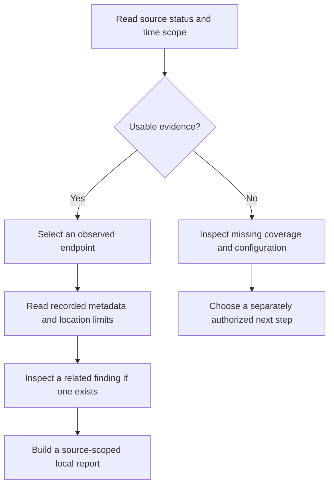

# Three investigation journeys

Start with a question, then follow the recorded evidence. These journeys use
implemented interfaces at [source `7c91232`](https://github.com/bartytime4life/MEGALODON/commit/7c912322b12fe40fbe92de79b32fdc678054a3da),
October 27, 2026. They are operator reading paths, not demonstrations that a
particular installed PC has collected data or detected a real incident.

## 1. What does this finding actually show?

Open **Findings**, use **Refine view** to choose a source and time range, and
select an observation. The search applies to the returned page; **Previous**
and **Next** reach additional pages. Read coverage before interpreting an
empty result. The activity ribbon describes the returned observations, not
every event on the network.

| Read | Ask | Keep the limit visible |
| --- | --- | --- |
| Recorded source and measurements | Which observed fact triggered this review? | Rule severity is not an AI risk score |
| Finding → linked event → ingestion receipt | Can I follow this result to its input and run? | A completed import is not proof of a live sensor |
| Observation, detection and projection times | Is this a current event or a refreshed view of old evidence? | Refreshing the screen does not refresh an observation |
| Evidence disclosures | Which fields and references are available? | Missing measurements are not reconstructed from current settings |

**Ask local AI** is optional. Read the interpretation, alternative explanation
and missing information separately. A bound response can still be wrong.
**Expected activity**, **Investigate** and **Incorrect match** save an assessment;
they do not disable a rule or authorize a restriction.

[Current Findings behavior](https://github.com/bartytime4life/MEGALODON/blob/7c912322b12fe40fbe92de79b32fdc678054a3da/docs/findings-review.md)
· [Inspector contract](https://github.com/bartytime4life/MEGALODON/blob/7c912322b12fe40fbe92de79b32fdc678054a3da/docs/control-room-contract.md#qualified-finding-evidence-inspector)

## 2. Where does the connection picture come from?

Start in **HUD** with source status, the selected interface and the connection
details. If collection is stopped, stale or unavailable, treat that as missing
coverage. Enabling collection is a separate operator choice with its own
permissions and scope; opening this guide does not start it.

The atlas places observed endpoints at approximate IP locations. Directional
motion represents recorded send/receive activity. It does not measure a
physical packet route, locate a person or prove hostile intent. Unmapped
endpoints remain in the details. Use **Pause motion** to inspect a stable view.

Packet records, sensor flow observations and interface rates answer different
questions. Do not add them into a single traffic total. A geolocation opt-in
has its own public download and internet-exit lookup scope.

[Atlas sources, limits and controls](https://github.com/bartytime4life/MEGALODON/blob/7c912322b12fe40fbe92de79b32fdc678054a3da/docs/live-connection-globe.md)
· [Recording and reports](https://github.com/bartytime4life/MEGALODON/blob/7c912322b12fe40fbe92de79b32fdc678054a3da/docs/efficient-recording-reports.md)

## 3. Did a host change make recovery necessary or possible?

Review AIDE baseline identity, comparison time and change categories before
interpreting a difference. Legitimate updates and operator edits also change
files. AIDE does not establish malware causality.

Recovery readiness keeps missing evidence visible. The external reader admits
two backup/test receipts against hashes in a separate operator-controlled
trust record. The trust record is not independently hash-pinned. An owner who
can rewrite all three files can forge the evidence. Different producer and
verifier IDs do not establish organizational independence.

Even admitted external evidence opens no backup, runs no restore test and grants
no host-file restoration. `restore_eligible` remains false. Audit-database
recovery and reference-library rollback are separately scoped capabilities.

[Host-security interpretation](https://github.com/bartytime4life/MEGALODON/blob/7c912322b12fe40fbe92de79b32fdc678054a3da/docs/host-security.md)
· [External backup-evidence contract](https://github.com/bartytime4life/MEGALODON/blob/7c912322b12fe40fbe92de79b32fdc678054a3da/docs/host-backup-evidence.md)

## Carry a defensible conclusion forward

A useful handoff names its source, observation window, recorded facts, gaps
and interpretation. Review local exports for private data before sharing.
An explanation, report or temporary containment preview is not evidence that
an action succeeded; read the separate workflow result and readback.

[Visual tour](visual-tour.md) · [Operator guide](operator-guide.md) ·
[Security boundaries](security-boundaries.md) · [Evidence index](evidence-index.md)
