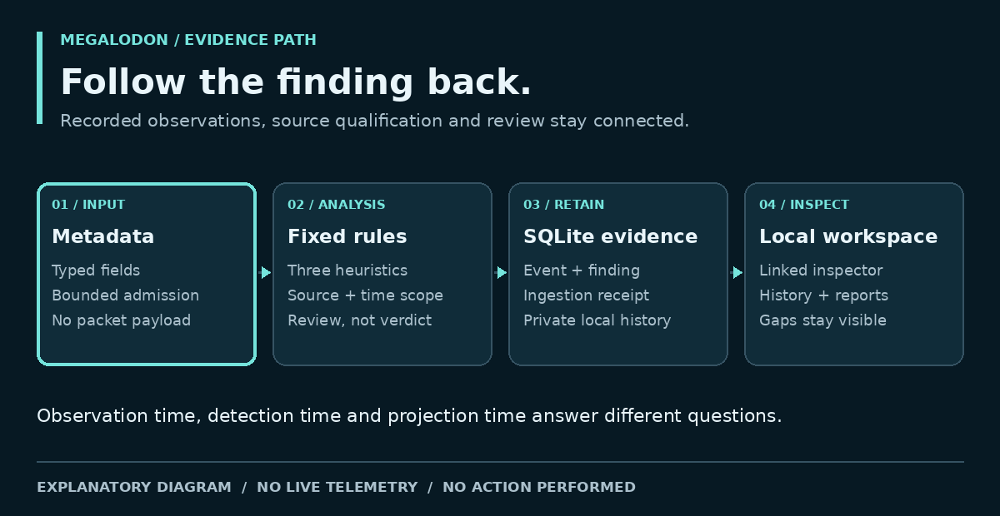
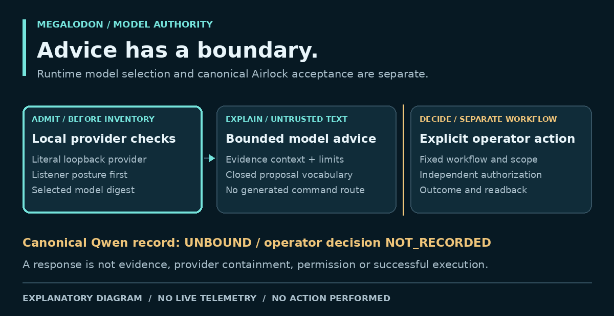
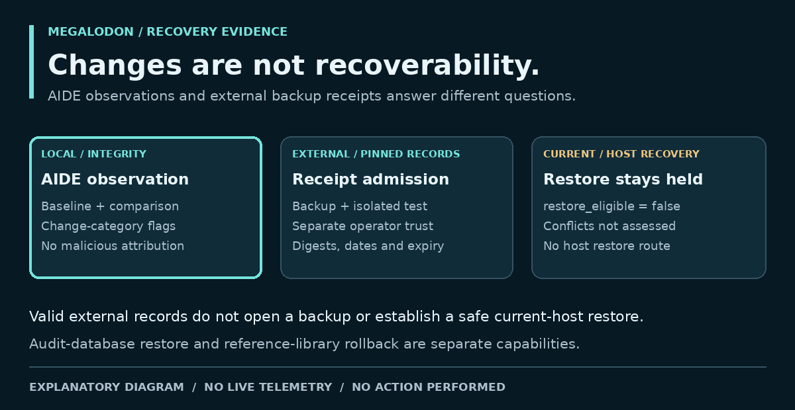

# Technical Deep Dive

**Current source reading:** [`418fa54474f3f77d0758e94aab5735a516d8c43b`](https://github.com/bartytime4life/MEGALODON/commit/418fa54474f3f77d0758e94aab5735a516d8c43b), November 11, 2026 (America/Chicago).
These are implemented source boundaries. Regression tests and hosted results
have narrower scope than installed-host or operational acceptance. Older pinned
links and diagrams below retain their October 22 source basis; they are not new
measurements of this revision.

## Current arithmetic and view identity

The later repairs preserve the distinction between a measurement, its display
and the evidence that permits a user action:

| Contract | Implementation and tests | Practical effect |
| --- | --- | --- |
| Exact hourly share admission; one history index per call | [Pattern engine](https://github.com/bartytime4life/MEGALODON/blob/418fa54474f3f77d0758e94aab5735a516d8c43b/megalodon/security_patterns.py), [arithmetic tests](https://github.com/bartytime4life/MEGALODON/blob/418fa54474f3f77d0758e94aab5735a516d8c43b/tests/test_pattern_comparison_math.py), [#771](https://github.com/bartytime4life/MEGALODON/pull/771) | Compare `100 × abs(nB − bC)` with `20 × CB` before rounding. History-key selection becomes `O(H + G)`; selected-distribution aggregation still costs work. |
| Aggregate CPU ticks before validation; round report percentages only at final output | [Host telemetry](https://github.com/bartytime4life/MEGALODON/blob/418fa54474f3f77d0758e94aab5735a516d8c43b/megalodon/host_telemetry.py), [telemetry tests](https://github.com/bartytime4life/MEGALODON/blob/418fa54474f3f77d0758e94aab5735a516d8c43b/tests/test_host_telemetry.py), [report tests](https://github.com/bartytime4life/MEGALODON/blob/418fa54474f3f77d0758e94aab5735a516d8c43b/tests/test_reporting.py), [#772](https://github.com/bartytime4life/MEGALODON/pull/772)/[#773](https://github.com/bartytime4life/MEGALODON/pull/773) | Avoid per-process/intermediate rounding drift. Impossible tick sums and missing samples remain unavailable; known-sample weights remain metric-specific. |
| Bind asynchronous views to identity and revision | [Reports client/tests](https://github.com/bartytime4life/MEGALODON/blob/418fa54474f3f77d0758e94aab5735a516d8c43b/tests/test_dashboard_reports_ui.py), [intelligence client/tests](https://github.com/bartytime4life/MEGALODON/blob/418fa54474f3f77d0758e94aab5735a516d8c43b/tests/test_dashboard_intelligence_ui.py), [#769](https://github.com/bartytime4life/MEGALODON/pull/769)/[#774](https://github.com/bartytime4life/MEGALODON/pull/774) | A late success or failure cannot replace the current report, reference search or selected device view, including A→B→A selection. Failed report pagination retries the same page. |
| Guide inspection without granting execution authority | [Guidance source](https://github.com/bartytime4life/MEGALODON/blob/418fa54474f3f77d0758e94aab5735a516d8c43b/megalodon/dashboard_operations.py), [state/focus tests](https://github.com/bartytime4life/MEGALODON/blob/418fa54474f3f77d0758e94aab5735a516d8c43b/tests/test_dashboard_guided_overview.py), [#774](https://github.com/bartytime4life/MEGALODON/pull/774) | Current source mode determines the next view. Sensor context stays separate from admitted Findings; summaries remain usable without packet capture; AI remains optional. |

The [pattern benchmark](https://github.com/bartytime4life/MEGALODON/blob/418fa54474f3f77d0758e94aab5735a516d8c43b/docs/benchmarks/pattern-comparison-20261111.json)
records finite synthetic timings, output equality and temporary-memory cost,
not production throughput or detection accuracy. The
[November documentation record](https://github.com/bartytime4life/MEGALODON/blob/main/docs/documentation-refresh-2026-11-11.md)
separates candidate tests, merged source identity and later verification. It does
not recast older workflow results as post-merge runs.

## The evidence path

<picture>
  <source media="(prefers-reduced-motion: reduce)" srcset="https://raw.githubusercontent.com/bartytime4life/MEGALODON/b24c1d38e1d30b108a021a9ef1d78ef5afdd120c/assets/docs/evidence-flow.png">
  
</picture>

[Still image](https://raw.githubusercontent.com/bartytime4life/MEGALODON/b24c1d38e1d30b108a021a9ef1d78ef5afdd120c/assets/docs/evidence-flow.png). Brief motion repeats twice and stops; all labels remain visible.

| Stage | Contract / implementation | Why the boundary matters |
| --- | --- | --- |
| Typed event | [`models.py`](https://github.com/bartytime4life/MEGALODON/blob/2cb706039724d9ea0bda09cbd3c17698b15ba55c/megalodon/models.py), [`validation.py`](https://github.com/bartytime4life/MEGALODON/blob/2cb706039724d9ea0bda09cbd3c17698b15ba55c/megalodon/validation.py) | Frozen `PacketEvent`; parsed IPs, ports, timestamps and flags; bounded lengths; reviewed metadata keys; no packet payload or payload-derived hash |
| Admission | [JSONL admission](https://github.com/bartytime4life/MEGALODON/blob/2cb706039724d9ea0bda09cbd3c17698b15ba55c/docs/jsonl-admission.md), [ingestion integrity](https://github.com/bartytime4life/MEGALODON/blob/2cb706039724d9ea0bda09cbd3c17698b15ba55c/docs/ingestion-integrity.md) | Source provenance and completeness are not inferred from a valid row |
| Detection | [`detector.py`](https://github.com/bartytime4life/MEGALODON/blob/2cb706039724d9ea0bda09cbd3c17698b15ba55c/megalodon/detector.py), [registry](https://github.com/bartytime4life/MEGALODON/blob/2cb706039724d9ea0bda09cbd3c17698b15ba55c/docs/detector-acceptance.md) | Bounded per-source windows and cooldowns; deterministic patterns, not trained classification |
| Persistence | [Storage layout](https://github.com/bartytime4life/MEGALODON/blob/2cb706039724d9ea0bda09cbd3c17698b15ba55c/docs/storage-layout.md), [managed evidence](https://github.com/bartytime4life/MEGALODON/blob/2cb706039724d9ea0bda09cbd3c17698b15ba55c/docs/managed-evidence.md) | Per-event atomic evidence; private segments; explicit capacity, failure and uncertain-commit handling |
| Read projection | [Query budget](https://github.com/bartytime4life/MEGALODON/blob/2cb706039724d9ea0bda09cbd3c17698b15ba55c/docs/dashboard-query-budget.md), [HTTP contract](https://github.com/bartytime4life/MEGALODON/blob/2cb706039724d9ea0bda09cbd3c17698b15ba55c/docs/dashboard-http-contract.md) | Existing compatible private DB, `mode=ro`, `query_only`, deny-by-default SQL authorization; bounded returned pages |
| Interpretation | [Finding inspector](https://github.com/bartytime4life/MEGALODON/blob/2cb706039724d9ea0bda09cbd3c17698b15ba55c/docs/control-room-contract.md#qualified-finding-evidence-inspector) | Linked event/run scope and separate clocks; a completed ingestion run is not a live sensor |

### Default core rules

| Rule | Trigger | Recorded severity | Important limit |
| --- | --- | --- | --- |
| `SYN_FLOOD` | ≥100 TCP SYN-without-ACK / source / 10 s | HIGH | Burst metadata can have legitimate explanations |
| `PORT_SCAN` | ≥20 distinct TCP destination ports / source / 5 s | MEDIUM | Inventory and authorized testing can match |
| `DNS_TUNNELING` | DNS/UDP query-length metadata ≥50 | CRITICAL | No content inspection or tunneling confirmation |

Source: [specification §4](https://github.com/bartytime4life/MEGALODON/blob/2cb706039724d9ea0bda09cbd3c17698b15ba55c/SPECIFICATION.md#4-fixed-mvp-rules).
Severity is the rule's fixed classification, not a calibrated probability or
incident verdict. Synthetic corpus results do not measure real-world accuracy.

### Three clocks, three questions

| Time | Question answered | Does not establish |
| --- | --- | --- |
| Observation time | When did the source say this event occurred? | Authentic source provenance or current activity |
| Detection time | When did analysis record this finding? | When a compromise began |
| Projection time | When was this view generated? | That old evidence became new |

Keep packet-event counts, interface byte rates, sensor flows and alert summaries
in their own units. Reports span retained segments and verified compact history;
they do not fill gaps or equate mixed sources. Defaults are 14 days / 20 GiB and
daily reports at 9 AM local time. [Recording contract](https://github.com/bartytime4life/MEGALODON/blob/2cb706039724d9ea0bda09cbd3c17698b15ba55c/docs/efficient-recording-reports.md).

## Local requests and host authority

Loopback binding is one layer. Host/Origin/request admission, scoped tokens or
configuration nonces, local-user checks and fixed route contracts supply the
rest. The core telemetry reader is read-only; protected Setup and host actions
are separate routes. A UI badge or catalog entry grants no authority.

The retained CLI firewall apply routes refuse before host interaction. The
separate Linux HUD containment path uses a current public endpoint, expiring
preview, explicit operator decision, OS authorization, protected targets, a fixed
managed nftables table and five-minute element timeouts. It can affect unrelated
connections to the same endpoint. This description is not an instruction or
authorization to operate it. [Defense contract](https://github.com/bartytime4life/MEGALODON/blob/2cb706039724d9ea0bda09cbd3c17698b15ba55c/docs/visual-operations-defense.md).

## AI admission before explanation

At the current November source, the [UNBOUND release fence](https://github.com/bartytime4life/MEGALODON/blob/418fa54474f3f77d0758e94aab5735a516d8c43b/docs/qwen-runtime-unbound.md)
refuses operational generation for every model family. Explicit bounded catalog
discovery/selection and the separate fixed no-telemetry READY diagnostic are
named exceptions; a saved model or passing diagnostic cannot lift the hold.
The older diagram and advisory boundaries below describe their recorded design
and history, not an enabled operational model path in this release.

<picture>
  <source media="(prefers-reduced-motion: reduce)" srcset="https://raw.githubusercontent.com/bartytime4life/MEGALODON/b24c1d38e1d30b108a021a9ef1d78ef5afdd120c/assets/docs/model-authority.png">
  
</picture>

[Still image](https://raw.githubusercontent.com/bartytime4life/MEGALODON/b24c1d38e1d30b108a021a9ef1d78ef5afdd120c/assets/docs/model-authority.png). Brief motion repeats twice and stops; all labels remain visible.

The provider's fixed literal-loopback endpoint is separate from the process
that operates Ollama. [PR #663](https://github.com/bartytime4life/MEGALODON/pull/663) makes model inventory use the
same listener-posture admission before a metadata request. An admitted listener,
an installed tag, a selected digest and a completed response prove different
things. They do not prove provider filesystem/egress containment or artifact
provenance. Model failures retain deterministic evidence and disclose the failed
attempt. Closed proposal vocabulary cannot become arbitrary command execution.
[Model selection](https://github.com/bartytime4life/MEGALODON/blob/2cb706039724d9ea0bda09cbd3c17698b15ba55c/docs/local-model-selection.md) and
[canonical Airlock](https://github.com/bartytime4life/MEGALODON/blob/2cb706039724d9ea0bda09cbd3c17698b15ba55c/docs/local-model-binding.md).

## Recovery evidence without a restore engine

<picture>
  <source media="(prefers-reduced-motion: reduce)" srcset="https://raw.githubusercontent.com/bartytime4life/MEGALODON/b24c1d38e1d30b108a021a9ef1d78ef5afdd120c/assets/docs/recovery-evidence.png">
  
</picture>

[Still image](https://raw.githubusercontent.com/bartytime4life/MEGALODON/b24c1d38e1d30b108a021a9ef1d78ef5afdd120c/assets/docs/recovery-evidence.png). Brief motion repeats twice and stops; all labels remain visible.

The `megalodon-recovery-readiness-v1` projection validates the already-loaded
host-security snapshot. It distinguishes initial baseline from comparison,
preserves boolean change categories, and clears partial observations on invalid
input. Every result retains `restore_eligible=False`, `backup_state=not_integrated`,
`causality_state=unavailable`, `conflict_state=not_assessed` and no action authority.

The separate `megalodon-backup-evidence-v1` reader admits exactly three fixed
private JSON files: operator trust, producer receipt and independent isolated
restore-test receipt. Only the two receipts are raw-byte hash-pinned by the
separate operator-controlled trust record; the trust record is not itself
independently hash-pinned. Each file is capped at 16 KiB. Closed keys/types, raw-byte
SHA-256 pins, source/artifact/snapshot identity and chronological ordering must
agree. Producer and verifier IDs must differ; meaningful independence is an
operator trust decision, not proof supplied by different strings. Each validity
interval is at most seven days; the earliest expiry governs and equality is
expired. No positive evidence cache survives a failed read or removed trust.

| Admission checks | Result | What it never proves |
| --- | --- | --- |
| Exact reviewed bytes, matching identities, isolated full-snapshot test, valid dates | `verified_external_evidence` | Clean files, current-host applicability, conflict clearance or safe restore |
| Missing, malformed, untrusted, conflicting, incomplete, expired or unreadable input | `unavailable`, fixed refusal reason; details cleared | Absence of every backup or proof of compromise |

File reads pin ancestry and descriptor identity, reject unsafe permissions and
links, and never follow a receipt-supplied path or URL. Digests are identity
pins, not issuer signatures; an owner who can rewrite trust and receipts can
forge them. No backup is opened, no test is run and no host file is restored.
[Complete contract](https://github.com/bartytime4life/MEGALODON/blob/2cb706039724d9ea0bda09cbd3c17698b15ba55c/docs/host-backup-evidence.md).

Audit-database backup/restore-to-new-destination and reference-library generation
rollback remain separate tools. Neither is operating-system recovery.

## Qualification and reproducibility

The current browser profile is `playwright-1.64.0-native-focus-v1`. It checks an
exact distributed driver module and modifies a temporary copy's one native-focus
setting; it does not edit the installed driver. Lock hashes, isolated test
profile and the browser assertion suite remain separate layers.
[Dependency policy](https://github.com/bartytime4life/MEGALODON/blob/2cb706039724d9ea0bda09cbd3c17698b15ba55c/docs/dependency-policy.md).

Core CI `39878396530`, Linux browser `39878396547` and CodeQL `39878396556`
succeeded at the October 22 source `2cb706039724d9ea0bda09cbd3c17698b15ba55c`. These are historical workflow results, not a fresh
run of this documentation or an independent security certification. Exact Zeek
producer acceptance (#445), canonical Qwen acceptance (#446), native platform
parity and installed-host recovery evidence remain separate.

[Practical applications](practical-applications.md) · [Evidence index](evidence-index.md) ·
[Security boundaries](security-boundaries.md)
